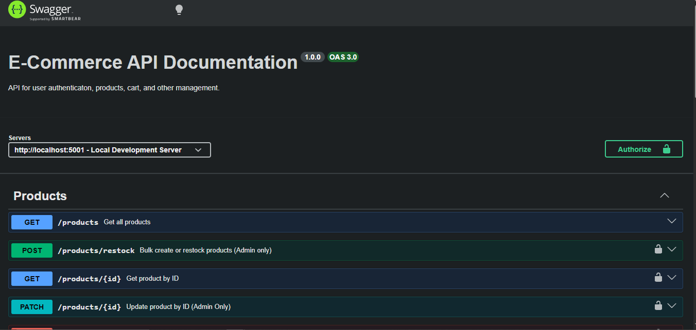

# Computer Gadgets Store API

A RESTful API for an e-commerce application focused on computer gadgets and accessories. Built with Node.js, Express and PostgreSQL, this project uses Prisma ORM for database operations and JWT for authentication.

## Features

### Authentication and User Management

- User registration and login.
- Password hashing with bcrypt.
- JWT-based authentication.
- Authenticated user profile retrieval.
- Password change and password recovery endpoints.
- Role-based access control for administrators.

### Product Management

- Retrieve all available products.
- Retrieve individual products.
- Create and restock products in bulk.
- Update product information.
- Delete products.
- Restrict product management operations to administrators.

### Shopping Cart

- Create or retrieve a user's cart.
- Add products to the cart.
- Update item quantities.
- Remove individual items.
- Clear the cart.

### Order Management

- Create orders from shopping cart items.
- Check product stock before order creation.
- Automatically update inventory after successful order creation.
- Retrieve customer order history and individual orders.
- Cancel pending orders and restore inventory.
- Admin access to all customer orders and order status management.

### Payment Integration

- Initialize payments through Paystack.
- Verify payment transactions.
- Handle Paystack webhook notifications.
- Update order payment status after successful verification.

## Technology Stack

| Technology        | Purpose                               |
| ----------------- | ------------------------------------- |
| Node.js           | JavaScript runtime                    |
| Express 5         | REST API framework                    |
| PostgreSQL        | Relational database                   |
| Prisma ORM        | Database access and schema management |
| JWT               | Authentication                        |
| bcrypt            | Password hashing                      |
| Swagger / OpenAPI | API documentation                     |
| Paystack          | Payment integration                   |
| Nodemailer        | Email delivery                        |
| Axios             | HTTP requests                         |

## Getting Started

### Prerequisites

Make sure you have installed:

- Node.js and npm
- PostgreSQL
- Git

Paystack credentials and SMTP credentials are required to test their respective integrations.

### 1. Clone the repository

\`\`\`bash
git clone https://github.com/wizcrafDev/computer-gadgets-store.git
cd computer-gadgets-store
\`\`\`

### 2. Install dependencies

\`\`\`bash
npm install
\`\`\`

### 3. Configure environment variables

Create a `.env` file in the project root and configure the following variables:

\`\`\`env
DATABASE_URL="your_postgresql_connection_string"
JWT_SECRET="your_jwt_secret"
ADMIN_REGISTRATION_SECRET="your_admin_registration_secret"

PAYSTACK_SECRET_KEY="your_paystack_secret_key"

SMTP_HOST="your_smtp_host"
SMTP_PORT="your_smtp_port"
EMAIL_USER="your_email_address"
EMAIL_PASS="your_email_password"
\`\`\`

Replace the placeholder values with your own credentials. Never commit your actual `.env` file or expose private API keys.

### 4. Generate the Prisma Client

\`\`\`bash
npx prisma generate
\`\`\`

Ensure your PostgreSQL database is configured and its schema is up to date before starting the application.

### 5. Start the development server

\`\`\`bash
npm run dev
\`\`\`

The server runs on:

\`\`\`
http://localhost:5001
\`\`\`

## API Documentation

Swagger UI is available at:

\`\`\`
http://localhost:5001/api-docs
\`\`\`

Use the documentation to explore available endpoints, inspect request parameters and test API operations.

### Swagger UI

The API documentation is available through Swagger UI when the server is running.

## Main API Routes

| Route           | Purpose                               |
| --------------- | ------------------------------------- |
| `/auth`         | Authentication and account management |
| `/users`        | User operations                       |
| `/products`     | Product management                    |
| `/cart`         | Shopping cart operations              |
| `/orders`       | Customer order operations             |
| `/admin/orders` | Administrative order management       |
| `/payments`     | Paystack payment operations           |

Protected endpoints require a valid JWT bearer token. Administrative endpoints also require administrator privileges.

## Project Structure

\`\`\`text
src/
├── config/
│ ├── db.js
│ └── email.js
├── controllers/
├── middlewares/
├── models/
├── routes/
├── app.js
└── server.js

prisma/
└── migrations/

prisma.config.ts
package.json
\`\`\`

## Author

**Nicholas Chukwuma**

GitHub: [@wizcrafDev](https://github.com/wizcrafDev)
